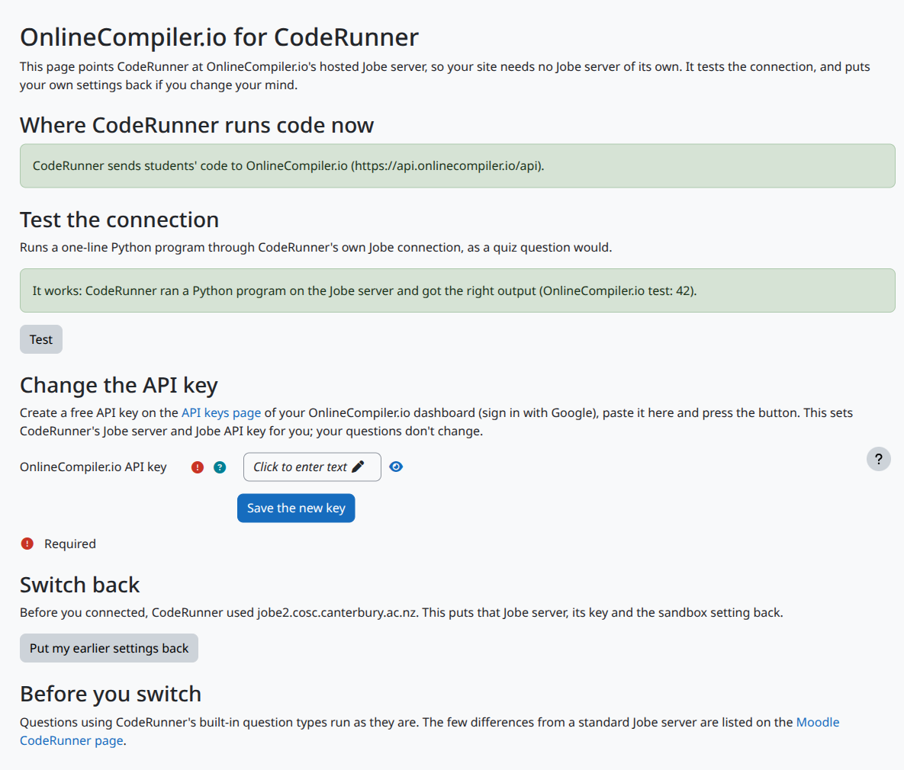

# OnlineCompiler.io for CodeRunner (Moodle plugin)

A Moodle admin tool that points [CodeRunner](https://moodle.org/plugins/qtype_coderunner) at [OnlineCompiler.io](https://onlinecompiler.io)'s hosted Jobe server, so your Moodle site needs no Jobe server of its own. Paste an API key and press one button: the plugin sets CodeRunner's Jobe server and Jobe API key, tests the connection the way a quiz question runs, and puts your own settings back whenever you want.

## Why

CodeRunner needs a Jobe server to compile and run students' code. Its built-in default is the University of Canterbury's demo server, which is meant for trying CodeRunner out and accepts only a limited number of runs an hour from one site. Running your own Jobe server means installing, patching and sizing it for exam days. OnlineCompiler.io runs a Jobe-compatible server for you, in isolated sandboxes with no network access, on servers in the European Union.

## What the plugin does

- **Connect in one step.** Paste an OnlineCompiler.io API key and press **Use OnlineCompiler.io for CodeRunner**. It sets CodeRunner's `jobe_host` to `https://api.onlinecompiler.io/api`, its `jobe_apikey` to your key, and turns CodeRunner's Jobe sandbox on. Your questions don't change.
- **Switch back at any time.** The first time you connect, it keeps your previous Jobe server, key and sandbox setting, and **Put my earlier settings back** restores them.
- **Test it.** **Test** runs a one-line Python program through CodeRunner's own Jobe sandbox class, exactly as a quiz question runs, and says in plain words what went wrong if it fails: a refused key, a Moodle server that can't reach the Jobe server (firewall or proxy), or a busy server.
- **See where code runs today:** OnlineCompiler.io, Canterbury's demo server, or another Jobe server.

Every change is recorded in Moodle's config changes report, with the API key shown as asterisks.

## Install

1. Install CodeRunner first (it is a dependency).
2. Download this repository as a ZIP and install it from **Site administration, Plugins, Install plugins**, or put it in `admin/tool/onlinecompiler` (`public/admin/tool/onlinecompiler` on Moodle 5.1 and later) and visit the notifications page.
3. Create a free API key on the [API keys page](https://api.onlinecompiler.io/compilers/api-keys/) of your OnlineCompiler.io dashboard (sign in with Google). The free plan needs no credit card, and the plugin needs nothing beyond it.
4. Open **Site administration, Plugins, Admin tools, OnlineCompiler.io for CodeRunner**, paste the key, connect, and press **Test**.

Requires Moodle 4.3 or later (the oldest CodeRunner supports) and CodeRunner. Tested on Moodle 5.3 with CodeRunner 5.10.9.

## Good to know

- Questions using CodeRunner's built-in question types run as they are. The few differences from a standard Jobe server are listed on the [Moodle CodeRunner page](https://onlinecompiler.io/moodle-coderunner#differences).
- Your Moodle server must be able to make outgoing HTTPS requests to `api.onlinecompiler.io`. Students' browsers only talk to Moodle.
- The plugin stores only the API key, in CodeRunner's own setting. It sends nothing itself except the test program, when an admin presses **Test**. Students' code reaches the Jobe server through CodeRunner, as with any Jobe server.

## Privacy

The plugin stores no personal data in Moodle. Its privacy provider declares what reaches OnlineCompiler.io once CodeRunner is connected: the code of each answer a student checks or submits, the question's input and files, and the language. CodeRunner sends these with the site's API key, not with the student's name, email or account. OnlineCompiler.io's [privacy policy](https://onlinecompiler.io/privacy) covers that data, and a [data processing agreement](https://onlinecompiler.io/dpa) is available.

## License

GPL v3 or later, like Moodle. See [LICENSE](LICENSE). Copyright 2026 RunCode Inc.
